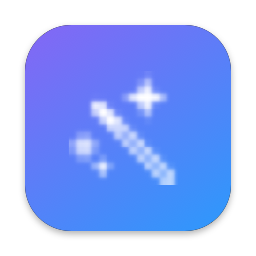

<p align="center"></p>

<h1 align="center">PromptPolish</h1>

<p align="center"><b>English</b> · <a href="README.ru.md">Русский</a></p>

A macOS menu bar utility that turns a rough idea typed into any AI chat into a structured, ready-to-send prompt. The model runs locally on your Mac — internet is needed only once, to download it (1.75 GB) — and no API keys.

Select text in a chat's input field → press **⌥⌘P** → a prompt tailored to that chat streams into a panel next to the text → **Заменить** (Replace). The text in the field is replaced and your clipboard stays exactly as it was.

**[Download the latest version](https://github.com/msyuge/PromptPolish/releases/latest)** · [User guide](docs/guide.md)

## How it works

1. **Reading the text.** The text is read from the focused input field via Accessibility. If an app doesn't expose it, PromptPolish copies it with ⌘C and then restores the clipboard.
2. **Detecting the chat.** In a browser, by the page address; for desktop apps, by bundle ID.

   | Chat | Detected by |
   |---|---|
   | Claude | claude.ai, Claude app |
   | ChatGPT | chatgpt.com, chat.openai.com, ChatGPT app |
   | Gemini | gemini.google.com, aistudio.google.com |
   | Perplexity | perplexity.ai, Perplexity app |
   | DeepSeek | chat.deepseek.com |
   | Grok | grok.com, x.com/i/grok |
   | Copilot | copilot.microsoft.com |
   | Le Chat | chat.mistral.ai |
   | anything else | general instruction |

3. **Generating the prompt.** A local model runs through [MLX](https://github.com/ml-explore/mlx-swift-lm) — Qwen3.5 2B (1.75 GB) by default; other models and Apple Intelligence built into macOS can be picked from the menu. Each chat has its own system instruction that follows its vendor's prompting guidance: XML tags for Claude, markdown sections for ChatGPT, a short search query for Perplexity, and so on. If the idea is too vague, the model asks 2–3 clarifying questions that you answer right in the panel.
4. **Replacing.** In native macOS fields the text is replaced via Accessibility; in browsers and Electron apps it is pasted with ⌘V. The clipboard is saved and restored completely — every item and every data type.

## Requirements

- macOS 14 or later, Apple Silicon.
- For the default model (Qwen3.5 2B): about 1.75 GB of disk space and about 2 GB of free memory while it's loaded (tested on an M2 with 8 GB). Other models: Qwen3.5 0.8B — 0.65 GB, Qwen3.5 4B — 3.1 GB. MLX models already downloaded in LM Studio are reused.

## Installation

1. Download `PromptPolish-<version>.dmg` from [Releases](https://github.com/msyuge/PromptPolish/releases/latest), open it and drag **PromptPolish** to **Applications**.
2. Launch PromptPolish from Applications — a magic wand icon appears in the menu bar. The app is signed with a Developer ID and notarized by Apple, so Gatekeeper shows no warnings.
3. Grant the Accessibility permission (see below).
4. On the first ⌥⌘P PromptPolish looks for an MLX model on disk and, if none is found, downloads Qwen3.5 2B (1.75 GB). Progress is shown in the menu.

To update, replace the app in Applications with the new version from the DMG. Settings, the chosen model and your system instruction edits are kept.

## Permissions

PromptPolish needs one permission — **Accessibility**: without it, it can't read text from another app's input field, replace it, or send ⌘C/⌘V.

1. macOS asks on first launch. If it didn't, choose **Выдать доступ к Accessibility…** (Grant Accessibility access) in the PromptPolish menu.
2. Turn PromptPolish on in **System Settings → Privacy & Security → Accessibility**.
3. PromptPolish notices the permission within a second — no restart needed.

App Sandbox is disabled because Accessibility is unavailable inside it. This is also why PromptPolish is not on the Mac App Store.

## Privacy

- Your prompts are processed only by the local model on your Mac and are never sent anywhere.
- No analytics, no telemetry. The only network access is to Hugging Face when downloading a model.
- The system log records only technical events (text length, detected chat, replacement method), never the text itself.

## Usage

| Action | How |
|---|---|
| Improve a prompt | select text (or just place the cursor in the field) → **⌥⌘P** |
| Replace the text in the field | **Заменить** (Replace) or **Return** |
| Copy the result | **Копировать** (Copy) or **⇧⌘C** — the only case where the clipboard changes |
| Answer the model's questions | type your answer → **Ответить** (Answer) or **⌘↩** |
| Close without changes | **Отмена** (Cancel) or **Esc** |

- If nothing is selected, the whole field is used.
- When generation finishes you can edit the result in the panel before replacing.
- The hotkey can be changed in **Настройки** (Settings).
- The interface is in Russian; English names are given in parentheses.

### Models

Choose the model from the **Модель** (Model) submenu or in **Настройки** (Settings). The choice is remembered; switching unloads the previous model from memory.

- **MLX models** run on any Apple Silicon Mac. Ollama models and LM Studio GGUF files can't be read by the built-in engine.
- **Apple Intelligence (experimental)** — built into macOS 26+: nothing to download, no PromptPolish memory used. But Apple doesn't officially support Russian, and with Russian instructions the model produces gibberish, empty replies or loops noticeably more often; it does better with English ideas. The context is limited to 4,096 tokens, and some topics are refused by Apple's safety guardrails.

- **На диске** (On disk) — MLX models you already have:
  - in LM Studio (`~/.lmstudio/models/<publisher>/<model>` and `~/.cache/lm-studio/models`);
  - in the Hugging Face cache (`~/.cache/huggingface/hub`).

  They are loaded straight from those folders: no second copy, no network, LM Studio doesn't need to be running.
- **Скачать с Hugging Face** (Download from Hugging Face) — verified models that fit this Mac's memory:

  | Model | Size | Notes |
  |---|---|---|
  | Qwen3.5 0.8B | ≈0.65 GB | fastest, but weak and inaccurate prompts |
  | Qwen3.5 2B | ≈1.8 GB | default: balance of size and quality |
  | Qwen3.5 4B | ≈3.1 GB | best quality on 8 GB |
  | Gemma 4 E2B | ≈3.6 GB | alternative from Google |
  | Gemma 4 E4B, Qwen3.5 9B | 5.2 and 6 GB | only with 12 GB of memory or more |

  Downloaded models go to the Hugging Face cache and work offline afterwards. Interrupted downloads resume where they stopped.

An MLX model is loaded into memory on the first ⌥⌘P and unloaded after 5 idle minutes, so it doesn't hold 2.5–3.4 GB while you're not using it. In **Настройки** (Settings) you can pick the delay (1 minute to 1 hour, or never) and turn on loading at launch; the menu also has **Выгрузить модель из памяти** (Unload model from memory).

### System instructions

Each chat's system instruction can be edited in **Настройки → Системные инструкции** (Settings → System instructions):

- the list of chats is on the left (a dot means the instruction is customized, a pencil means unsaved edits), the editor is on the right;
- **Сохранить** (Save, ⌘S) applies the change to the next ⌥⌘P, no restart needed;
- **Сбросить к стандартной** (Reset to default) restores the instruction shipped with the app;
- **Показать файл в Finder** (Show file in Finder) — edits are stored in `~/Library/Application Support/PromptPolish/SystemPrompts/SystemPrompt-<chat>.txt` and can be edited in any text editor.

The default instructions live in `PromptPolish/Resources/SystemPrompts/`.

## Known limitations

- **Model quality.** Small models sometimes get details wrong; Qwen3.5 0.8B writes noticeably weaker prompts, 2B is better, 4B is best. Models (for example, describes language syntax incorrectly). Skim the result before replacing.
- **Speed.** On an M2 a response takes from a few seconds (0.8B) to 30 seconds (4B), a long prompt up to a minute. The model also needs 1–4 seconds to load from disk before the first prompt.
- **Frequent clarifying questions.** The model often asks even when the idea is clear enough — a consequence of rule 4 in the general instruction.
- **Small-model defects.** Occasionally the model produces a prompt that asks the chat to "write a prompt", copies its own instruction into the result, or breaks XML tags. PromptPolish detects this and asks the model to rewrite up to two times; if the defect remains, the offending lines are removed. Each correction adds 10–30 seconds.
- **Memory.** A loaded Qwen3.5 2B takes about 2 GB, 0.8B about 1 GB, 4B 2.5–3.4 GB; Apple Intelligence runs in macOS's memory. That's why the model isn't loaded at launch: it loads on the first ⌥⌘P (2–4 seconds from disk) and is unloaded after 5 idle minutes — both can be changed in Settings. Don't keep a model loaded in LM Studio or Ollama at the same time on an 8 GB Mac.
- **Browsers and Electron apps** always get the text via ⌘V. If a site transforms pasted text (for example, renders markdown), that affects the result.
- **Keyboard layouts.** Synthetic ⌘A/⌘C/⌘V use ANSI key codes. QWERTY and Russian layouts work; plain Dvorak doesn't, "Dvorak – QWERTY ⌘" does.
- **Secure input.** Password fields are skipped. If another app has Secure Keyboard Entry on (for example, Terminal), macOS blocks synthetic key presses.
- **Clipboard managers.** Temporary text is marked `org.nspasteboard.TransientType`, which most managers ignore. They may record the restored clipboard contents again.

## Building from source

Requires Xcode (tested with 27.1), [XcodeGen](https://github.com/yonaskolb/XcodeGen) and the Metal Toolchain.

```bash
brew install xcodegen
```

```bash
xcodebuild -downloadComponent MetalToolchain
```

```bash
make install
```

`make install` builds the Release configuration, copies it to `~/Applications/PromptPolish.app` and launches it. The first build takes several minutes because MLX and its Metal shaders are compiled.

Debug builds are signed with **Apple Development**, Release builds with **Developer ID Application** (team `6ALXRXJXN6` in `project.yml`). To build under another account, change `DEVELOPMENT_TEAM` and `scripts/ExportOptions.plist`. Keep the signing identity stable between builds, otherwise macOS resets the Accessibility permission after every rebuild.

| Command | What it does |
|---|---|
| `make build` | Debug build into `build/DerivedData` |
| `make run` | build and relaunch the Debug app |
| `make test` | unit tests |
| `make integration` | real generation on the model for every chat, report in `build/integration-output.txt` |
| `make install` | Release build into `~/Applications` |
| `make dmg` | signed DMG without notarization |
| `make release` | DMG signed with Developer ID and notarized |
| `make icon` | regenerate the app icon (`scripts/make-icon.swift`) |

Logs (prompt text is never logged):

```bash
/usr/bin/log show --last 30m --info --predicate 'subsystem == "com.alekseimaksimov.promptpolish"'
```

Architecture notes and design decisions are in [CLAUDE.md](CLAUDE.md) (in Russian); the next phase plan is in [docs/phase2.md](docs/phase2.md).

## Releasing

Create a notarization profile in the keychain once, replacing `you@example.com` with your Apple ID. You'll need an [app-specific password](https://account.apple.com/account/manage) (Sign-In and Security → App-Specific Passwords); the command asks for it:

```bash
xcrun notarytool store-credentials PromptPolish --apple-id you@example.com --team-id 6ALXRXJXN6
```

Then bump `CFBundleShortVersionString` and `CFBundleVersion` in `project.yml` and run:

```bash
make release
```

`scripts/release.sh` regenerates the third-party license file, archives and exports the app with Developer ID and Hardened Runtime, notarizes and staples the app, builds `build/release/PromptPolish-<version>.dmg`, signs, notarizes and staples the DMG, checks it with Gatekeeper and writes its SHA-256. Publish it:

```bash
gh release create v1.0.1 build/release/PromptPolish-1.0.1.dmg build/release/PromptPolish-1.0.1.dmg.sha256
```

## License

PromptPolish is released under the [MIT License](LICENSE).

Third-party license texts are bundled in `PromptPolish/Resources/Acknowledgements.txt` and available in the app under **Настройки → Лицензии** (Settings → Licenses). Main components: [mlx-swift](https://github.com/ml-explore/mlx-swift) and [mlx-swift-lm](https://github.com/ml-explore/mlx-swift-lm) (MIT), [swift-transformers](https://github.com/huggingface/swift-transformers) and [swift-huggingface](https://github.com/huggingface/swift-huggingface) (Apache-2.0), [KeyboardShortcuts](https://github.com/sindresorhus/KeyboardShortcuts) (MIT).

Models are not bundled: users download them, and the models' own licenses apply — Qwen3.5 is Apache-2.0, Gemma 4 is under the [Gemma Terms of Use](https://ai.google.dev/gemma/terms).
